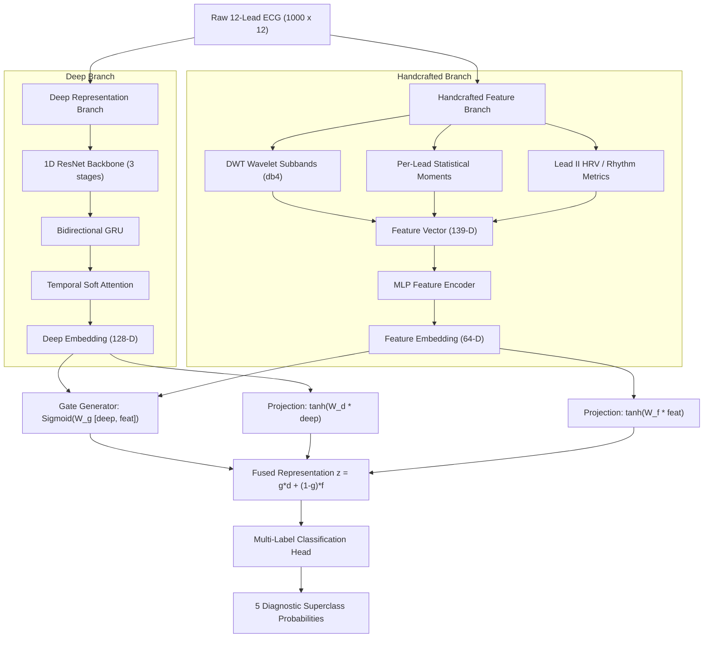

# System Architecture & Technical Specifications

**PTB-XL ECG Intelligence: Hybrid Deep Learning with Adaptive Gated Fusion**

---

## 1. System Overview
The architecture is designed for multi-label diagnostic classification of 12-lead electrocardiograms into five clinical superclasses:
- `NORM`: Normal ECG
- `MI`: Myocardial Infarction
- `STTC`: ST/T Change
- `CD`: Conduction Disturbance
- `HYP`: Hypertrophy

The primary research contribution is an **Adaptive Gated Fusion Mechanism** that dynamically arbitrates information flow between deep spatio-temporal representations and clinical handcrafted features.

---

## 2. Component Specifications

### 2.1 Deep Representation Branch
- **Input**: $(B, 12, 1000)$ normalised signals.
- **Stem**: 1D Convolution (12 $\to$ 32, kernel 15, stride 2, padding 7) + BatchNorm1d + ReLU.
- **Residual Stages**: 3 stages of Residual Blocks with projection shortcuts:
  - Stage 1: $32 \to 64$, stride 2, kernel 7.
  - Stage 2: $64 \to 128$, stride 2, kernel 7.
  - Stage 3: $128 \to 128$, stride 2, kernel 7.
- **Sequence Modeling**: Bidirectional GRU with hidden dimension 64 per direction (total 128-D).
- **Temporal Attention**: Learnable context vector pooling across time steps.
- **Deep Embedding Output**: Tensor of shape $(B, 128)$.

### 2.2 Handcrafted Feature Branch
- **Wavelet Subbands**: 4-level Discrete Wavelet Transform (`db4`) yielding 5 subband relative energy ratios per lead ($12 \times 5 = 60$).
- **Per-Lead Moments**: Mean, standard deviation, peak-to-peak amplitude, skewness, kurtosis, and mean absolute successive difference ($12 \times 6 = 72$).
- **Rhythm & HRV**: Lead II Pan-Tompkins QRS peak detection extracting 7 metrics: peak count, mean RR, std RR, RMSSD, min RR, max RR, pNN50.
- **Total Dimensions**: 139 features.
- **MLP Encoder**: Linear(139, 128) $\to$ BatchNorm1d $\to$ ReLU $\to$ Dropout(0.3) $\to$ Linear(128, 64) $\to$ ReLU. Output: $(B, 64)$.

### 2.3 Adaptive Gated Fusion
- Let $h_{\text{deep}} \in \mathbb{R}^{128}$ and $h_{\text{feat}} \in \mathbb{R}^{64}$.
- Gate vector $g \in (0, 1)^{96}$:
  $$g = \sigma(W_g [h_{\text{deep}} \,\|\, h_{\text{feat}}] + b_g)$$
- Projections into shared latent space $\mathbb{R}^{96}$:
  $$\tilde{h}_{\text{deep}} = \tanh(W_d h_{\text{deep}} + b_d), \quad \tilde{h}_{\text{feat}} = \tanh(W_f h_{\text{feat}} + b_f)$$
- Fused representation:
  $$z = g \odot \tilde{h}_{\text{deep}} + (1 - g) \odot \tilde{h}_{\text{feat}}$$

### 2.4 Multi-Label Classification Head
- Dropout(0.3) $\to$ Linear(96, 64) $\to$ ReLU $\to$ Linear(64, 5).
- Loss function: Binary Cross-Entropy with Logits and clamped positive class weights to mitigate severe class imbalance.
